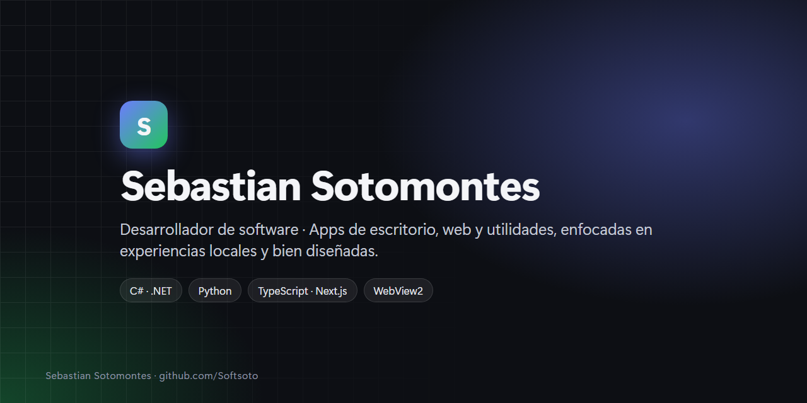

  

<h1 align="center">¡Hola! Soy Sebastian 👋</h1>

Desarrollo <b>aplicaciones de escritorio, web y utilidades</b>, con especial cariño por las experiencias
<b>locales</b> (que funcionan sin servidores ni cuentas), <b>bien diseñadas</b> y pensadas para gente real.

  
  
  
  
  
  
  

---

## 🌟 Proyecto destacado (público)

### [comanda](https://github.com/Softsoto/comanda) — Menú digital con pedidos por WhatsApp
Menú digital **gratis** para pequeños negocios: el cliente arma su pedido desde el celular y te llega por WhatsApp.
Multi-comercio, panel de pedidos, reportes, cupones, domicilios, planes y código QR. **Next.js 16 · TypeScript · PostgreSQL.**
→ **[Ver el repositorio](https://github.com/Softsoto/comanda)**

---

## 🗂️ Portafolio

> La mayoría del código es **privado**. Con gusto doy acceso de solo lectura a quien quiera revisarlo.

### 🖥️ Aplicaciones de escritorio (C# / .NET)
| Proyecto | Qué hace |
|---|---|
| **OmniCare** | Centro de control universal para Windows con funciones por marca (ASUS, Lenovo, Dell, HP, Acer, MSI, Surface). |
| **VeloxDM** | Gestor de descargas: segmentación dinámica, colas, vídeo, BitTorrent y extensión de navegador. |
| **Mercado Manager** | Administra una tienda de Mercado Libre desde el escritorio, 100% local, con la API oficial. |
| **LivePaper** | Fondos de pantalla animados con un motor de render WebGL propio. |
| **Copropiedades** | Administración de conjuntos y edificios: cartera, asambleas, PQRS, correos y finanzas. |
| **EcMenu X** | Personaliza el menú contextual de Windows con +50 acciones. |

### 🌐 Web y utilidades
| Proyecto | Qué hace |
|---|---|
| **CRM Personal** | Panel de vida personal: credenciales, 2FA, finanzas, notas, proyectos y más. |
| **Editor PDF · Cuentas de cobro · Recibos · Plantillas · Convertidor de extensiones** | Herramientas web que corren 100% en el navegador, sin servidor. |
| **Epic Intelligence** | Lee y ordena el PDF de exportación de datos de una cuenta de Epic Games. |

### 🐍 Python y 🪟 PowerShell
| Proyecto | Qué hace |
|---|---|
| **SSA Studio** | Cifrado AES, esteganografía y un formato propio `.SSA`. |
| **Transcriptor de Audio** | Audio y video a texto con Whisper, en local. |
| **HD Guardian** | Monitor de salud de discos (SMART) para Windows. |
| **SquadCats** | Visor del casillero de Fortnite con login oficial por device-code. |

---

  
  <!-- Añade aquí tu LinkedIn:  -->

Hecho con mucho café ☕ · © 2026 Sebastian Sotomontes

