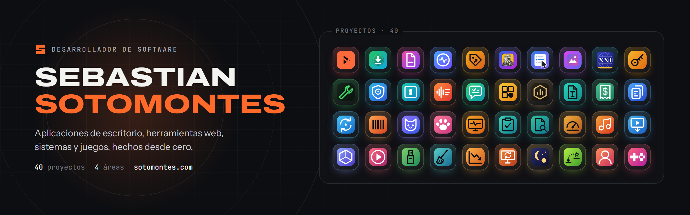
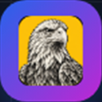
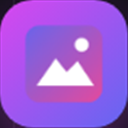

  

<h1 align="center">Sebastian Sotomontes</h1>

Desarrollo <b>aplicaciones de escritorio, herramientas web, sistemas y juegos</b>, hechos desde cero. 
Me gusta el software <b>local</b>, que funciona sin servidores ni cuentas, <b>bien diseñado</b> y pensado para gente real.

  
  

  
  
  
  
  
  
  
  
  
  
  

> Cada repositorio es una **presentación**: capturas, cómo se usa y cómo funciona por dentro. El código vive en repositorios privados.

### Aplicaciones de escritorio

| | Proyecto | Qué hace | Versión | Lo último |
|:-:|---|---|:-:|---|
|  | [**SOTO PLAYER**](https://github.com/Softsoto/SotoPlayer) Tauri 2 · Rust · React · libmpv | Plataforma multimedia para Windows: video, música, streams de red y TV en vivo en una sola app, con skins y complementos. | `v0.1.0` Funcional | Complementos de catálogo con películas, series, fuentes y subtítulos. |
|  | [**VeloxDM**](https://github.com/Softsoto/VeloxDM) C# · .NET 10 · WebView2 | Gestor de descargas con segmentación dinámica, colas, planificador, video, BitTorrent y extensión de navegador. | `v0.5.2` Funcional | Si un sitio exige una verificación, la descarga abre tu navegador para que la resuelvas tú. |
|  | [**PDF Studio**](https://github.com/Softsoto/PDF-Studio) Electron · Vite · pdf-lib | Editor de PDF completo: crear, editar, anotar, firmar, OCR, formularios y exportar a Office. | `v0.5.0` En desarrollo | Versión 0.5.0 con unas 60 herramientas y plantillas editables. |
|  | [**OmniCare**](https://github.com/Softsoto/OmniCare) C# · .NET 10 · WebView2 | Centro de control para Windows: rendimiento, batería, diagnóstico y actualizaciones, con funciones específicas por marca de equipo. | `v0.1.0` En desarrollo | Primera versión con funciones para ocho marcas de equipos. |
|  | [**Mercado Manager**](https://github.com/Softsoto/MercadoManager) C# · WPF · Blazor Hybrid · SQLite | Administra una tienda de Mercado Libre desde el escritorio, 100 % local y con la API oficial: publicaciones, ventas, envíos y rentabilidad. | `v1.2.0` Estable | Interfaz rediseñada, preguntas y mensajes de posventa. |
|  | [**Copropiedades**](https://github.com/Softsoto/Copropiedades) C# · .NET 10 · WPF · SQLite | Administración de conjuntos y edificios: cartera, asambleas, PQRS, contratos, presupuesto y correos masivos. | `v2.4.0` Estable | Centro de gestión con indicadores, agenda de hoy y agenda global. |
|  | [**EcMenu X**](https://github.com/Softsoto/EcMenuX) C# · .NET 10 · WPF | Personaliza el clic derecho de Windows con más de 50 acciones, submenús y un limpiador, sin permisos de administrador. | `v2.0.0` Estable | Versión 2.0 con interfaz Fluent, limpiador y más de 50 acciones. |
|  | [**LivePaper**](https://github.com/Softsoto/LivePaper) C# · .NET 10 · WebGL | Fondos de pantalla animados: escenas 2D y 3D, video, web y apps, con un motor de render WebGL propio. | `v1.0.0` Estable | Versión 1.0 con motor WebGL propio y editor Crear. |
|  | [**SigloNav**](https://github.com/Softsoto/SigloNav) C# · WebView2 · IE11 | Navegador de doble motor: Chromium para la web actual e Internet Explorer 11 con Java para aplicativos heredados, en la misma ventana. | `v1.1.2` Estable | Activa Java web sola en los equipos donde estaba deshabilitado. |
|  | [**Enterprise SSO**](https://github.com/Softsoto/EnterpriseSSO) C# · .NET 10 · AES-256-GCM | Bóveda de credenciales cifrada que inicia sesión sola en aplicativos web y de escritorio, con una única clave maestra. | `v0.1.0` En desarrollo | Varias cuentas por dominio con selector. |
|  | [**LegionFix**](https://github.com/Softsoto/LegionFix) C# · .NET 10 · WPF | Diagnóstico y reparación de Windows con una interfaz cinematográfica, donde cada contador y hallazgo es un dato real del equipo. | `v1.0.0` Funcional | Versión en C# con modo diagnóstico que no modifica nada. |
|  | [**HD Guardian**](https://github.com/Softsoto/HDGuardian) PowerShell · WMI | Monitor de salud de discos: estado SMART, temperatura, horas de uso y alertas. | `v1.0` Funcional | Lectura SMART con alertas por disco. |
|  | [**SSA Studio**](https://github.com/Softsoto/SSA-Studio) Python · Criptografía | Cifrado AES, esteganografía y un formato propio .SSA para esconder y proteger archivos dentro de imágenes y audio. | `v2.1` Estable | Formato .SSA con verificación de integridad. |
|  | [**Transcriptor de Audio**](https://github.com/Softsoto/Transcriptor-Audio) Python · Whisper | Convierte audio y video a texto con Whisper, en tu propio equipo y sin enviar nada a la nube. | `v1.0` Estable | Selección de modelo y progreso en vivo. |

### Web y herramientas en el navegador

| | Proyecto | Qué hace | Versión | Lo último |
|:-:|---|---|:-:|---|
|  | [**Comanda**](https://github.com/Softsoto/comanda) Next.js 16 · TypeScript · PostgreSQL | Menú digital gratis para pequeños negocios: el cliente arma su pedido desde el celular y llega por WhatsApp. | `v1.0` Funcional | Multi-comercio con panel, reportes, cupones y código QR. |
|  | [**CRM Personal**](https://github.com/Softsoto/CRM-Personal) HTML · JavaScript · Node | Panel personal todo en uno: credenciales, 2FA, notas, proyectos, finanzas, recibos y suscripciones. | `v1.0` Funcional | Panel con patrimonio, gastos y recordatorios. |
|  | [**Epic Intelligence**](https://github.com/Softsoto/epic-intelligence) HTML · JavaScript | Convierte el PDF de exportación de datos de una cuenta de Epic Games en un panel claro, todo en el navegador. | `v1.2` Funcional | Interfaz en español e inglés. |
|  | [**Editor PDF**](https://github.com/Softsoto/editor-pdf) HTML · JavaScript | Anota, agrega texto y formas, rota o reordena páginas y exporta. El documento nunca sale de tu equipo. | `v1.0` Funcional | Combinar documentos y exportar anotaciones dentro del PDF. |
|  | [**Cuentas de cobro**](https://github.com/Softsoto/cuentas-de-cobro) HTML · JavaScript | Genera cuentas de cobro en PDF con el valor en letras calculado solo, para independientes en Colombia. | `v1.0` Funcional | Valor en letras automático y descarga en PDF. |
|  | [**Generador de plantillas**](https://github.com/Softsoto/generador-plantillas) HTML · JavaScript | Contratos, cartas y facturas con campos dinámicos y contadores, listos para exportar a PDF. | `v4.0` Funcional | Modos Editar, Llenar y Factura con marca de agua. |
|  | [**Convertidor de extensiones**](https://github.com/Softsoto/convertidor-extensiones) HTML · JavaScript | Renombra, numera, cambia la extensión y comprime muchos archivos a la vez, sin subirlos a ningún servidor. | `v1.0` Estable | Funciona sin conexión y comprime en ZIP. |
|  | [**Generador de recibos**](https://github.com/Softsoto/generador-recibos) HTML · JavaScript | Recibos de pago editables sobre el propio documento, con códigos de barras GS1 generados a partir de los plazos. | `v1.0` Estable | Códigos de barras GS1-128 por cada plazo. |
|  | [**SquadCats**](https://github.com/Softsoto/SquadCats) Python · FastAPI | Visor del casillero de Fortnite en una app web local, con inicio de sesión oficial por device-code. | `v1.0` Funcional | Versión web local y de escritorio con la misma lógica. |
|  | [**Comederos de las gatas**](https://github.com/Softsoto/ComederoGatas) Python · Tuya | Una sola web para controlar dos comederos inteligentes, por WiFi local o por la nube. | `v1.0` Funcional | Importación automática de dispositivos y vista de cámara. |
|  | [**Estación de diagnóstico**](https://github.com/Softsoto/EstacionDiagnostico) HTML · JavaScript | Banco de pruebas de hardware que corre desde una USB, sin internet, y genera un acta de servicio firmada. | `v1.0` Estable | Acta de servicio con firma y resultados autollenados. |
|  | [**Generador de informes**](https://github.com/Softsoto/GeneradorInformes) HTML · jsPDF | Informes de reparación y soporte, virtuales o presenciales, con vista previa en vivo y PDF profesional. | `v1.0` Estable | Vista previa en vivo y PDF numerado por secciones. |
|  | [**Analizador de metadatos PDF**](https://github.com/Softsoto/AnalizadorMetadatosPDF) HTML · pdf.js | Muestra lo que un PDF trae por dentro: autor, fechas, estructura, permisos y metadatos XMP. | `v1.0` Funcional | Modo demo y exportación a JSON o TXT. |
|  | [**Dashboard personal**](https://github.com/Softsoto/DashboardPersonal) HTML · JavaScript | Tareas, gastos, notas y Pomodoro en un panel con estética de monitoreo de servidores. | `v1.0` Funcional | Copia de seguridad para exportar e importar tus datos. |
|  | [**Extractor de Audio**](https://github.com/Softsoto/ExtractorAudio) JavaScript · WebAssembly | Saca el audio de un video en el navegador, con FFmpeg en WebAssembly y sin subir el archivo. | `v1.0` Funcional | Procesa videos pesados dentro del navegador. |
|  | [**Telegram Video Saver**](https://github.com/Softsoto/TelegramVideoSaver) JavaScript · Manifest V3 | Extensión de navegador que guarda en tu equipo los videos que ya puedes ver en Telegram Web. | `v1.0` Funcional | Descarga por bloques con reintentos y guardado directo a disco. |

### Sistemas, móvil y automatización

| | Proyecto | Qué hace | Versión | Lo último |
|:-:|---|---|:-:|---|
|  | [**SotOS**](https://github.com/Softsoto/SotOS) Debian 13 · KDE Plasma 6 · Python | Distribución GNU/Linux basada en Debian 13 y KDE Plasma 6, con una identidad visual propia. | `Inicial` En desarrollo | Base del proyecto definida: Debian 13, KDE Plasma 6 y estilo SotOS Glass. |
|  | [**Cinora**](https://github.com/Softsoto/Cinora) Swift · SwiftUI · Go | App para iPhone que organiza películas y series, con reproductor híbrido y motor de torrents propio. | `Beta` En desarrollo | Reproductor híbrido con cambio automático según el formato. |
|  | [**USB de herramientas**](https://github.com/Softsoto/UsbHerramientas) Ventoy · PowerShell | USB de servicio técnico con arranque múltiple y un menú propio ordenado por categorías. | `Fase 1` En desarrollo | Menú de arranque por categorías con tema propio. |
|  | [**Limpiador de metadatos**](https://github.com/Softsoto/LimpiadorMetadatos) Python | Elimina de imágenes, documentos de Office y PDF los datos ocultos como autor, fechas y ubicación GPS. | `v1.0` Funcional | Limpia imágenes, Office y PDF, también por carpetas. |
|  | [**Amazon Price Tracker**](https://github.com/Softsoto/AmazonPriceTracker) Python · BeautifulSoup | Vigila precios de Amazon y avisa por WhatsApp cuando un producto baja de tu precio objetivo. | `v1.0` Funcional | Aviso por WhatsApp sin repetir el mismo precio. |
|  | [**DDNS para escritorio remoto**](https://github.com/Softsoto/DdnsEscritorioRemoto) PowerShell · Cloudflare API | Mantiene un dominio apuntando a una IP dinámica para llegar a un equipo por escritorio remoto. | `v1.0` Funcional | Actualiza el registro solo cuando cambia la IP. |

### Juegos y mods

| | Proyecto | Qué hace | Versión | Lo último |
|:-:|---|---|:-:|---|
|  | [**Dos Lunas**](https://sotomontes.com/arcade/) TypeScript · Canvas · React | Trece juegos en pixel art hechos desde cero: pinball, carreras, laberintos, mascotas y más, con logros y puntajes. | `v1.0` Estable | Ya se puede jugar en esta web: 13 juegos, logros y secretos. |
|  | **Operación Quilcue** Unity 6 · C# · URP | Juego de plataformas 3D con seis mundos, jefes y medallas, y niveles que un bot recorre con física real para validarlos. | `v0.2.0` En desarrollo | Seis mundos jugables con jefes y medallas. |
|  | **Avatar Creator HTML5** HTML5 · JavaScript | Versión en HTML5 de un creador de avatares que dependía de Flash, en tres idiomas y sin instalación. | `v1.0` Estable | Funciona sin Flash ni instalación, en tres idiomas. |
|  | **SPEX Studio** Modding · Editor | Editor de mods para Scott Pilgrim EX: niveles, personajes, poderes, sprites y textos, aplicados en memoria sin tocar la carpeta del juego. | `v1.0` Funcional | Editor de niveles, personajes, poderes, sprites y textos. |

---

© 2026 Sebastian Sotomontes · <a href="https://sotomontes.com">sotomontes.com</a>

